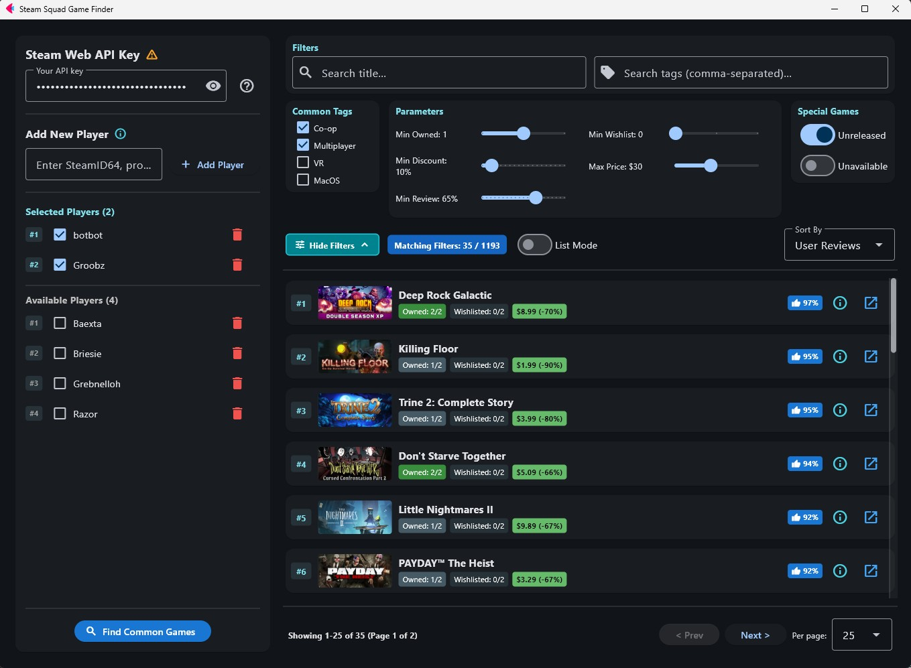

# Steam Friends Game Finder

Find common Steam games across your friend group's libraries and wishlists. Built with Python. Basic app built years ago, then improved and extended in 2026. Not really battle-tested, but worked well enough so far.



The same code runs as a desktop app or as a web app.

## Features

- Add friends via Steam ID, custom name, or profile URL
- Compare owned games and wishlists across selected players
- View prices, discounts, review scores, and tags
- Filter by number of players owning/wishlisting the game, price, discount, reviews, etc.
- Combine the Min Owned and Min Wishlist filters with AND or OR (click the chip between them)
- Copy the titles of all matching games with the button next to Sort (all pages, in the current sort order)
- Export Squad / Import Squad: share or back up your player list as an `SSF1:` code (never includes the API key)
- Discord Activity support (web only)

## Requirements

- Python 3.11
- A [Steam Web API Key](https://steamcommunity.com/dev/apikey)
- Target Steam profiles must have their Game details privacy set to Public

## Desktop

1. Install dependencies:
   ```bash
   pip install -r requirements.txt
   ```

2. Run the app:
   ```bash
   python run_desktop.py
   ```

3. Paste your Steam Web API key in the top-left field, add your friends' Steam profiles, and click Find Common Games.

Your API key and player list are stored **in plain text** in `steam_friends_game_finder_config.json` in the folder you start the app from.

Prebuilt binaries for Windows, macOS and Linux are on the Releases page.

## Web

1. Install dependencies:
   ```bash
   pip install -r requirements-web.txt
   ```

2. Start the server:
   ```bash
   python run_web.py
   ```

3. Open http://localhost:8181.

The server stores no API key and no config file. Each visitor enters their own Steam Web API key. The key and player list stay in that browser's local storage.

You can also start the server with `uvicorn src.web.server:app --host 0.0.0.0 --port 8181`.

### Environment variables

| Name | Default | Meaning |
| --- | --- | --- |
| `HOST` | `0.0.0.0` | Address the server listens on. |
| `PORT` | `8181` | Port the server listens on. Hosts like Render, Railway and Fly set this for you. |
| `DISCORD_CLIENT_ID` | empty | Discord Application ID for the Activity. Only needed if it cannot be read from the hostname (see below). |
| `PROXY_STEAM_IMAGES` | `1` | Serve Steam images through this server. Needed inside Discord and avoids browser CORS problems. Set to `0`, `false`, `no` or `off` to turn it off. |

### Discord Activity

The web app can also run inside Discord as an Activity. This is optional: without it, the app works as a normal website.

- In the Discord Developer Portal, map the Activity's root URL (`/`) to your server.
- The client ID is read from the `<client_id>.discordsays.com` hostname. Set `DISCORD_CLIENT_ID` only to override it.
- The server loads the Discord Embedded App SDK from esm.sh and serves it from its own origin. To host the SDK yourself, put the bundle at `src/web/discord-embedded-app-sdk.mjs`.
- Discord may clear the Activity's storage. Keep a squad code from Export Squad as a backup.

## Development

```bash
pip install -r requirements-dev.txt
pytest
```

`requirements-dev.txt` includes the web requirements, because the tests also cover the web server.
