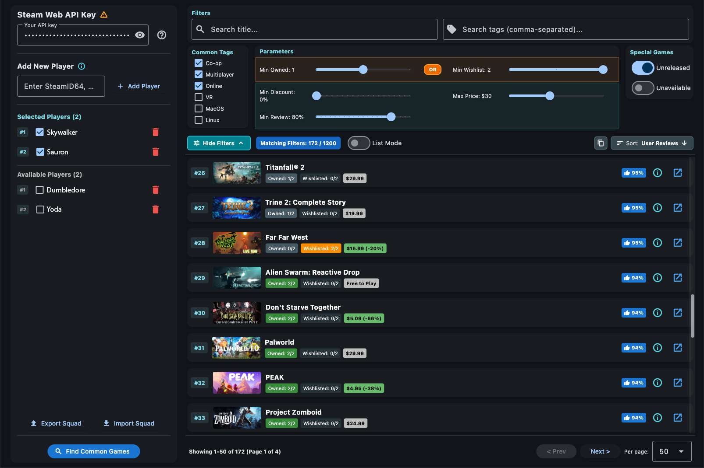

#  Steam Friends Game Finder

Find common Steam games across your friends' libraries and wishlists. Runs as a desktop app or a web app (also inside Discord as an Activity).



## Features

- Add friends by SteamID64, vanity name or profile URL
- Compare owned games and wishlists across the selected players
- See prices (USD), discounts, review scores and tags
- Filter by how many players own or wishlist a game, price, discount, reviews, tags and more
- Combine the filters to answer questions like "which co-op games under $10 do at least 3 of us own or have on a wishlist?"
- Copy the titles of all matching games
- Export / Import Squad: share your player list as an `SSF1:` code (never includes the API key)

## Requirements

- Python 3.11
- A [Steam Web API Key](https://steamcommunity.com/dev/apikey)
- The players' Steam "Game details" privacy setting must be Public

```bash
pip install -r requirements.txt
```

## Desktop

```bash
python run_desktop.py
```

The API key and player list are stored **in plain text** in `steam_friends_game_finder_config.json` in the folder you start the app from.

Prebuilt binaries for Windows, macOS and Linux are on the Releases page (built by `.github/workflows/release.yml` when you push a `v*` tag).

## Web

```bash
python run_web.py
```

Then open http://localhost:8181. Set `PORT` to use a different port.

The server stores nothing. Each user enters their own API key, which stays in their browser's local storage together with the player list.

## Tests

```bash
pip install -r requirements-dev.txt
pytest
```
