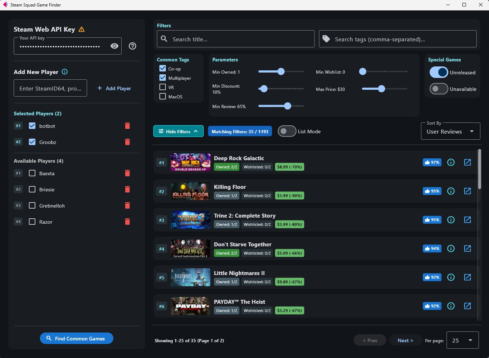

# Steam Friends Game Finder

Find common Steam games across your friend group's libraries and wishlists. Built with Python. Basic app built years ago, then improved and extended in 2026. Not really battle-tested, but worked well enough so far.



## Features

- Add friends via Steam ID, custom name, or profile URL
- Compare owned games and wishlists across selected players
- View prices, discounts, review scores, and tags
- Filter by number of players owning/wishlisting the game, price, discount, reviews, etc.
- Stores API key and player IDs (**in plain text**)

## Requirements

- Python 3.9+
- A [Steam Web API Key](https://steamcommunity.com/dev/apikey)
- Target Steam profiles must have their Game details privacy set to Public

## Installation & Usage

1. Install dependencies:
   ```bash
   pip install flet httpx

2. Run the app:
   ```bash
   python main.py
   ```

3. Paste your Steam Web API key in the top-left field, add your friends' Steam profiles, and click Find Common Games. Your API key and saved player list are stored locally in `steam_finder_config.json`.